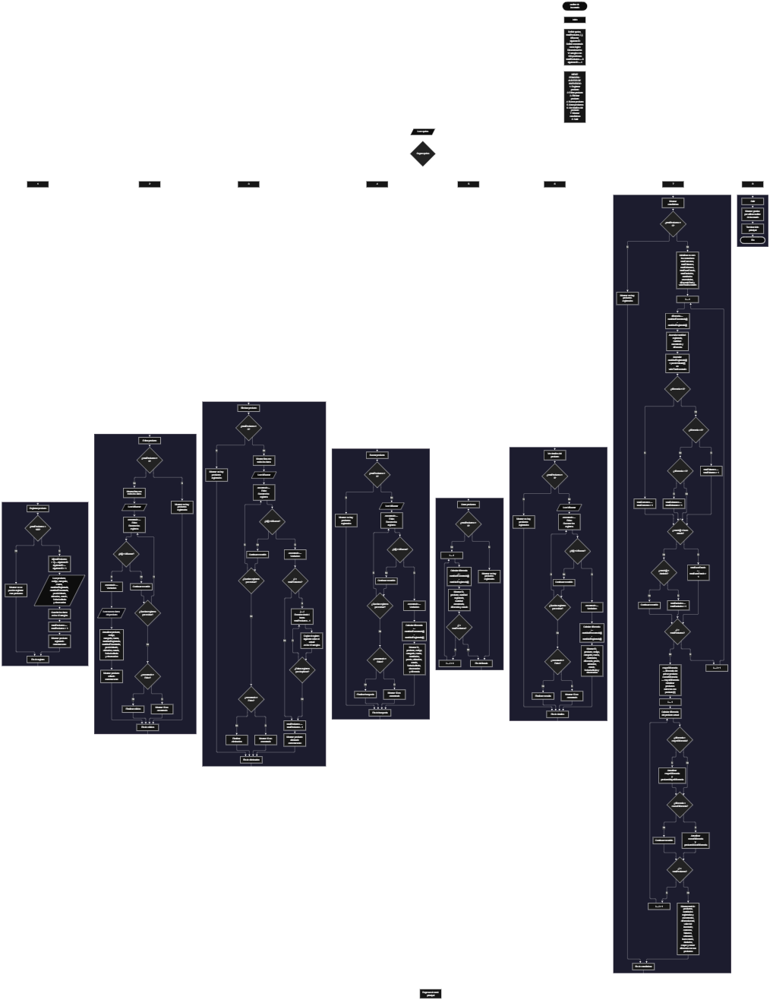

 

Este proyecto, llamado <b>auditor de inventario</b>, fue desarrollado en <b>pseint</b> como un ejercicio práctico para fortalecer la lógica de programación mediante la creación de un sistema de gestión y auditoría de productos desde la consola. El programa cuenta con un menú principal de ocho opciones que permite <b>registrar, editar, eliminar, buscar, listar, consultar los detalles y mostrar estadísticas</b> de los productos registrados. Cada producto almacena información como el nombre, el código, la categoría, la marca, las cantidades registradas y encontradas, el precio unitario, la ubicación, el estado, la fecha de auditoría y una observación. Los datos se organizan mediante doce arreglos paralelos con una capacidad máxima de <b>100 productos durante la ejecución</b>. Durante su desarrollo se aplicaron conceptos fundamentales de programación, como variables, arreglos, estructuras condicionales, ciclos repetitivos, estructuras de selección, contadores y acumuladores. Además, se implementaron operaciones para comparar las existencias, identificar faltantes y sobrantes, calcular el valor del inventario y obtener estadísticas generales de la auditoría.

<h2 align="center">⚙️ Funcionamiento del menú principal</h2>

### ➕ Registrar producto

La opción <b>1) registrar producto</b> permite agregar un nuevo producto al sistema de auditoría de inventario. Antes de realizar el registro, el programa comprueba que la cantidad de productos almacenados sea inferior a <b>100</b>, utilizando la condición <b>totalproductos &lt; 100</b>. Si existe espacio disponible, asigna un identificador mediante el arreglo <b>id</b> y la variable <b>siguienteid</b>, que aumenta en uno para preparar el identificador del próximo producto. Después, solicita el <b>nombre, código, categoría, marca, cantidad registrada, cantidad encontrada, precio unitario, ubicación, estado, fecha de auditoría y observación</b>. Los datos se almacenan en la posición correspondiente de sus respectivos arreglos. Finalmente, aumenta la variable <b>totalproductos</b> en uno y muestra el mensaje <b>"producto registrado correctamente."</b>. Si se alcanza la capacidad máxima, presenta el mensaje <b>"no se pueden registrar mas productos."</b>, impidiendo registrar otro producto.

### ✏️ Editar producto

La opción <b>2) editar producto</b> permite modificar la información de un producto registrado. Primero, el programa comprueba si existen productos almacenados mediante la variable <b>totalproductos</b>. Si no hay registros, muestra el mensaje <b>"no hay productos registrados."</b>. En caso contrario, presenta una lista con el identificador, nombre, código, categoría, marca, cantidades, precio unitario, ubicación, estado, fecha de auditoría y observación de cada producto. Después, solicita el identificador del producto que se desea editar y utiliza la variable lógica <b>encontrado</b> para determinar si existe una coincidencia. Si encuentra el identificador, solicita los nuevos datos y actualiza directamente los arreglos correspondientes, conservando el identificador original. Finalmente, muestra el mensaje <b>"producto editado correctamente."</b>. Si termina el recorrido sin encontrar el identificador solicitado, presenta el mensaje <b>"no se encontro un producto con ese id."</b>.

### 🗑️ Eliminar producto

La opción <b>3) eliminar producto</b> permite eliminar un producto registrado mediante su identificador. Antes de comenzar, el programa comprueba si existen productos almacenados. Si el inventario está vacío, muestra el mensaje <b>"no hay productos registrados."</b>. Si hay registros disponibles, presenta una lista con la información almacenada y solicita el identificador del producto que se desea eliminar. Después, inicializa la variable lógica <b>encontrado</b> con el valor <b>falso</b> y recorre los registros hasta localizar una coincidencia. Cuando encuentra el identificador, cambia la variable a <b>verdadero</b>. Si el producto no ocupa la última posición, utiliza un ciclo <b>para</b> controlado por la variable <b>j</b> para desplazar los datos posteriores una posición hacia atrás en los doce arreglos: <b>id, producto, codigo, categoria, marca, cantidadregistrada, cantidadencontrada, preciounitario, ubicacion, estado, fechaauditoria y observacion</b>. Posteriormente, disminuye la variable <b>totalproductos</b> en uno y muestra el mensaje <b>"producto eliminado correctamente."</b>. Si no encuentra el identificador, presenta el mensaje <b>"no se encontro un producto con ese id."</b>. En el código actual, la cantidad de productos se modifica dentro del ciclo de búsqueda y no se limpia explícitamente la última posición que deja de formar parte de los registros activos.

### 🔎 Buscar producto

La opción <b>4) buscar producto</b> permite localizar un producto mediante su identificador. Primero, el programa comprueba si existen productos registrados. Si el inventario está vacío, muestra el mensaje <b>"no hay productos registrados."</b>. En caso contrario, solicita el identificador del producto que se desea buscar e inicializa la variable lógica <b>encontrado</b> con el valor <b>falso</b>. A continuación, utiliza un ciclo <b>para</b> para recorrer los identificadores almacenados y compararlos con el valor introducido mediante la condición <b>id[i] = idbuscar</b>. Cuando encuentra una coincidencia, cambia la variable a <b>verdadero</b> y muestra los datos completos del producto, incluyendo su nombre, código, categoría, marca, cantidades, precio, ubicación, estado, fecha de auditoría y observación. Además, calcula la diferencia mediante la expresión <b>cantidadencontrada[i] - cantidadregistrada[i]</b>. Si finaliza el recorrido sin encontrar coincidencias, presenta el mensaje <b>"no se encontro un producto con ese id."</b>.

### 📋 Listar productos

La opción <b>5) listar productos</b> permite visualizar un resumen de los productos registrados. Antes de mostrar la información, el programa comprueba si la variable <b>totalproductos</b> es igual a cero. Si no existen registros, presenta el mensaje <b>"no hay productos registrados."</b>. Si hay productos disponibles, utiliza un ciclo <b>para</b> para recorrer los arreglos desde la primera posición hasta el total de productos almacenados. Durante el recorrido, calcula la diferencia entre la cantidad encontrada y la cantidad registrada de cada producto. Después, muestra el identificador, nombre, cantidad registrada, cantidad encontrada, diferencia y estado. Esta función facilita comparar las existencias registradas con las encontradas durante la auditoría sin necesidad de consultar individualmente todos los detalles de cada producto.

### 📄 Ver detalles del producto

La opción <b>6) ver detalles del producto</b> permite consultar la información completa de un producto específico. Primero, el programa comprueba si existen productos registrados. Si el inventario está vacío, muestra el mensaje <b>"no hay productos registrados."</b>. En caso contrario, solicita el identificador del producto que se desea consultar e inicializa la variable <b>encontrado</b> con el valor <b>falso</b>. Después, recorre los registros para localizar el identificador introducido. Si encuentra una coincidencia, calcula la diferencia entre las cantidades encontradas y registradas y muestra el identificador, nombre, código, categoría, marca, cantidad registrada, cantidad encontrada, diferencia, precio unitario, ubicación, estado, fecha de auditoría y observación. Si no encuentra el identificador solicitado, presenta el mensaje <b>"no se encontro un producto con ese id."</b>. Esta opción permite examinar individualmente los datos utilizados durante la auditoría.

### 📊 Mostrar estadísticas

La opción <b>7) mostrar estadisticas</b> permite obtener un resumen de los resultados de la auditoría de inventario. Primero, el programa comprueba si existen productos registrados. Si no hay registros, muestra el mensaje <b>"no hay productos registrados."</b>. En caso contrario, inicializa los contadores y acumuladores utilizados para calcular las estadísticas. Mediante un primer ciclo <b>para</b>, recorre los productos y calcula la diferencia entre las cantidades encontradas y registradas. También acumula la cantidad total registrada, la cantidad total encontrada, la diferencia total y el valor del inventario, utilizando la cantidad registrada multiplicada por el precio unitario de cada producto. Además, clasifica los productos en tres grupos: sin diferencias, con faltantes y con sobrantes. También cuenta los productos en <b>buen estado</b> y los productos <b>daniados</b>, de acuerdo con el texto almacenado en el arreglo de estado. Posteriormente, utiliza un segundo recorrido para identificar la mayor y la menor diferencia, guardando los nombres de los productos correspondientes. Finalmente, muestra el total de productos, las cantidades acumuladas, el valor total del inventario, las clasificaciones por diferencia y estado, y los productos asociados a los valores extremos. La clasificación de mayor sobrante y mayor faltante corresponde a la diferencia numérica más alta y más baja, respectivamente, por lo que el nombre de esos indicadores depende de los valores realmente registrados.

### 🚪 Salir del menú principal

La opción <b>8) salir</b> permite finalizar la ejecución del programa y muestra el mensaje <b>"gracias por utilizar auditor de inventario."</b>. El menú principal se encuentra dentro de una estructura repetitiva <b>repetir ... hasta que</b>, que mantiene el sistema en funcionamiento mientras se realizan las operaciones disponibles. La condición de salida es <b>hasta que opcion = 8</b>, por lo que, al seleccionar la opción 8, el ciclo principal termina y la ejecución del algoritmo finaliza.

<h2 align="center">🧠 Temas aplicados en el proyecto</h2>

### 📦 Variables

En este proyecto se utilizan variables para controlar las opciones del menú, la cantidad de productos registrados, los identificadores, los recorridos de los arreglos y los resultados de las operaciones. También se utilizan variables para comprobar si se encontró un producto, almacenar las diferencias entre cantidades y calcular las estadísticas de la auditoría. Cada variable cumple una función específica dentro del sistema y permite organizar los datos necesarios para administrar y analizar el inventario.

🔢 **opcion:** Almacena la opción seleccionada por el usuario en el menú principal.

📊 **totalproductos:** Controla la cantidad de productos registrados actualmente.

🆔 **siguienteid:** Almacena el identificador que se asignará al próximo producto.

🔄 **i:** Funciona como contador para recorrer los arreglos durante las operaciones del programa.

🔁 **j:** Controla el desplazamiento de los registros posteriores durante la eliminación de un producto.

🔎 **idbuscar:** Almacena el identificador introducido por el usuario para buscar, editar o eliminar un producto.

✅ **encontrado:** Variable lógica que indica si se localizó el identificador solicitado.

📉 **diferencia:** Almacena el resultado de restar la cantidad registrada a la cantidad encontrada.

📈 **diferenciatotal:** Acumula las diferencias calculadas para todos los productos registrados.

💰 **valortotalinventario:** Acumula el valor de los productos utilizando las cantidades registradas y sus precios unitarios.

📊 **mayordiferencia y menordiferencia:** Guardan los valores de la diferencia numérica más alta y más baja encontrados durante el análisis.

🏷️ **productomayordiferencia y productomenordiferencia:** Almacenan los nombres asociados a la mayor y menor diferencia, respectivamente.

### 🗃️ Arreglos

En este proyecto se utilizan doce arreglos paralelos con una capacidad de <b>100 posiciones</b> cada uno. Todos comparten el mismo índice para representar la información correspondiente a un mismo producto. Por ejemplo, los datos del producto almacenado en la posición <b>1</b> se encuentran distribuidos entre <b>id[1], producto[1], codigo[1], categoria[1], marca[1], cantidadregistrada[1], cantidadencontrada[1], preciounitario[1], ubicacion[1], estado[1], fechaauditoria[1] y observacion[1]</b>. Esta organización permite registrar, consultar, modificar, eliminar y analizar los productos de manera ordenada durante la ejecución.

🆔 **id[100]:** Almacena los identificadores de los productos.

📦 **producto[100]:** Almacena los nombres de los productos.

🏷️ **codigo[100]:** Almacena los códigos de los productos.

🗂️ **categoria[100]:** Almacena las categorías de los productos.

🏭 **marca[100]:** Almacena las marcas de los productos.

📝 **cantidadregistrada[100]:** Almacena las cantidades registradas en el inventario.

🔍 **cantidadencontrada[100]:** Almacena las cantidades encontradas durante la auditoría.

💲 **preciounitario[100]:** Almacena los precios unitarios de los productos.

📍 **ubicacion[100]:** Almacena la ubicación de cada producto.

🛠️ **estado[100]:** Almacena el estado del producto, como buen estado o dañado.

📅 **fechaauditoria[100]:** Almacena la fecha de auditoría.

📄 **observacion[100]:** Almacena las observaciones correspondientes a cada producto.

### 🔀 Estructuras condicionales

En este proyecto se utilizan estructuras <b>si</b> y <b>sino</b> para comprobar si existe espacio disponible antes de registrar un producto, verificar si el inventario está vacío antes de ejecutar determinadas operaciones y determinar si un identificador coincide con alguno de los registros almacenados. También permiten clasificar los productos según su diferencia de cantidades: si la diferencia es igual a cero, el producto se considera sin diferencias; si es menor que cero, se contabiliza como faltante; y si es mayor que cero, se contabiliza como sobrante. Asimismo, se utilizan condiciones para contar los productos según su estado y para identificar los valores máximos y mínimos de las diferencias.

### 🔄 Estructuras repetitivas

En este proyecto se utilizan los ciclos <b>para</b> y <b>repetir ... hasta que</b>. Los ciclos <b>para</b> permiten recorrer los arreglos para mostrar productos, localizar identificadores, actualizar información, desplazar registros durante la eliminación y calcular estadísticas. También se utilizan para acumular cantidades, calcular el valor total del inventario y encontrar los productos asociados a las diferencias más altas y más bajas. Por otro lado, el ciclo <b>repetir ... hasta que</b> mantiene activo el menú principal hasta que el usuario selecciona la opción 8, permitiendo realizar varias operaciones durante una misma ejecución.

### 🎯 Estructura según

El programa utiliza la estructura <b>segun</b> para evaluar el valor almacenado en la variable <b>opcion</b> y ejecutar el bloque de instrucciones correspondiente. Cada caso representa una operación específica: <b>registrar producto, editar producto, eliminar producto, buscar producto, listar productos, ver detalles del producto, mostrar estadisticas o salir</b>. También incluye el bloque <b>de otro modo</b>, que muestra el mensaje <b>"opcion no valida."</b> cuando el usuario introduce un valor que no coincide con ninguna de las opciones definidas en el menú.

### 🔢 Dimensionamiento de arreglos

El programa utiliza la instrucción <b>dimension</b> para establecer una capacidad de <b>100 posiciones</b> en cada uno de los doce arreglos. Esta configuración permite administrar hasta cien productos durante la ejecución. La cantidad de registros activos se controla mediante la variable <b>totalproductos</b>, por lo que los ciclos recorren las posiciones comprendidas entre la primera y la última posición ocupada. El identificador de cada nuevo producto se genera mediante la variable <b>siguienteid</b>, que aumenta después de asignar cada identificador y no se reinicia cuando se elimina un registro.

### ➖ Cálculo de diferencias

El cálculo de diferencias es una parte fundamental del proyecto porque permite comparar las cantidades registradas con las encontradas durante la auditoría. Para obtener este resultado, el programa resta la cantidad registrada a la cantidad encontrada mediante la expresión <b>cantidadencontrada[i] - cantidadregistrada[i]</b>. Si el resultado es igual a cero, las cantidades coinciden; si es negativo, existe un faltante; y si es positivo, existe un sobrante. Este cálculo se utiliza en las opciones de búsqueda, listado, detalles y estadísticas, y permite identificar discrepancias entre los registros del inventario y las cantidades encontradas.

### 📊 Contadores y acumuladores

El programa utiliza contadores y acumuladores para calcular los resultados generales de la auditoría. Las variables <b>totalcorrectos, totalfaltantes y totalsobrantes</b> contabilizan los productos según su diferencia de cantidades. Las variables <b>totalbuenestado y totaldaniados</b> cuentan los productos según su estado. Por su parte, <b>cantidadtotalregistrada, cantidadtotalencontrada y diferenciatotal</b> acumulan las cantidades registradas, encontradas y sus diferencias. Finalmente, <b>valortotalinventario</b> acumula el valor calculado a partir de la cantidad registrada de cada producto y su precio unitario. Estos resultados se muestran en la opción de estadísticas.

<h2 align="center">¿Cómo se implementaron las operaciones crud en el proyecto?</h2>

Las operaciones <b>crud</b> se implementaron mediante las opciones del menú principal, permitiendo administrar los productos registrados en el sistema. La operación <b>crear</b> corresponde a <b>registrar producto</b>, donde se introducen los datos de un nuevo producto; <b>leer</b> se realiza mediante las opciones <b>buscar producto, listar productos y ver detalles del producto</b>; <b>actualizar</b> corresponde a <b>editar producto</b>, donde se modifican los datos de un producto existente; y <b>eliminar</b> se realiza mediante la opción <b>eliminar producto</b>, que desplaza los registros posteriores cuando corresponde y disminuye el total de productos activos. Además, la opción de estadísticas amplía las posibilidades de consulta al calcular diferencias, clasificar existencias y resumir el valor del inventario. Todas estas operaciones trabajan con los arreglos y las variables que se mantienen en memoria durante la ejecución.

<h2 align="center">Diagrama de flujo del proyecto</h2>

<h2 align="center">🛡️ Validaciones del programa</h2>

### 📭 No existen productos registrados

Esta comprobación se utiliza en las opciones de <b>editar, eliminar, buscar, listar, ver detalles y mostrar estadisticas</b>. El programa verifica si la variable <b>totalproductos</b> es igual a <b>0</b> y, si no existen registros, muestra el mensaje <b>"no hay productos registrados."</b>. De esta manera, las operaciones que necesitan información almacenada no continúan con sus recorridos cuando el inventario está vacío.

### ⚠️ Inventario lleno

Esta comprobación se utiliza durante el registro de nuevos productos. El programa verifica si <b>totalproductos &gt;= 100</b> antes de solicitar los datos. Si el inventario ha alcanzado la capacidad máxima, muestra el mensaje <b>"no se pueden registrar mas productos."</b>. Si existe espacio disponible, asigna el identificador, solicita los datos del producto y aumenta el contador de registros.

### ❌ Producto no encontrado

Esta comprobación se utiliza durante las operaciones de edición, eliminación, búsqueda y consulta de detalles. El programa inicializa la variable lógica <b>encontrado</b> con el valor <b>falso</b> y recorre el arreglo de identificadores para compararlos con el valor introducido por el usuario. Cuando encuentra una coincidencia, cambia la variable a <b>verdadero</b> y ejecuta la operación correspondiente. Si al terminar el recorrido no se ha encontrado el identificador solicitado, muestra el mensaje <b>"no se encontro un producto con ese id."</b>. El código no incluye una instrucción para detener inmediatamente todos estos recorridos al encontrar una coincidencia.

### ⚖️ Clasificación de diferencias

Durante el cálculo de estadísticas, el programa comprueba si la diferencia entre las cantidades encontradas y registradas es igual, menor o mayor que cero. Si la diferencia es igual a cero, aumenta el contador de productos sin diferencias; si es menor que cero, aumenta el contador de productos con faltantes; y si es mayor que cero, aumenta el contador de productos con sobrantes. Esta clasificación depende del resultado de la resta y no de una validación independiente de las cantidades introducidas.

### 🛠️ Clasificación por estado

El programa utiliza las condiciones <b>estado[i] = "buen estado"</b> y <b>estado[i] = "daniado"</b> para contar los productos según su estado. Las comparaciones se realizan con los textos exactos definidos en el código. Aunque durante el registro se solicita introducir uno de estos estados, el programa no comprueba que el usuario haya escrito uno de los valores esperados ni convierte automáticamente las entradas a un formato uniforme.

### ⚠️ Opción inválida

La estructura <b>segun</b> incluye el bloque <b>de otro modo</b>, que muestra el mensaje <b>"opcion no valida."</b> cuando el usuario introduce una opción que no coincide con los casos del menú. Esta comprobación informa de la selección no reconocida, pero no valida ni limita el resto de los datos introducidos durante el registro o la edición de productos.

<h2 align="center">🎯 Objetivo del proyecto</h2>

El objetivo principal de este proyecto es fortalecer la <b>lógica de programación</b> mediante el desarrollo de un sistema de gestión y auditoría de inventario en <b>pseint</b>. A través de su construcción se busca aplicar los conocimientos adquiridos sobre variables, arreglos, estructuras condicionales, ciclos repetitivos, estructuras de selección, contadores y acumuladores, integrándolos para resolver un problema de administración de existencias. Además, el proyecto permite comprender cómo registrar, consultar, modificar y eliminar productos, comparar las cantidades registradas con las encontradas, identificar faltantes y sobrantes y calcular estadísticas generales del inventario. De esta manera, constituye una base para desarrollar sistemas de auditoría y gestión más avanzados utilizando otros lenguajes y tecnologías.

